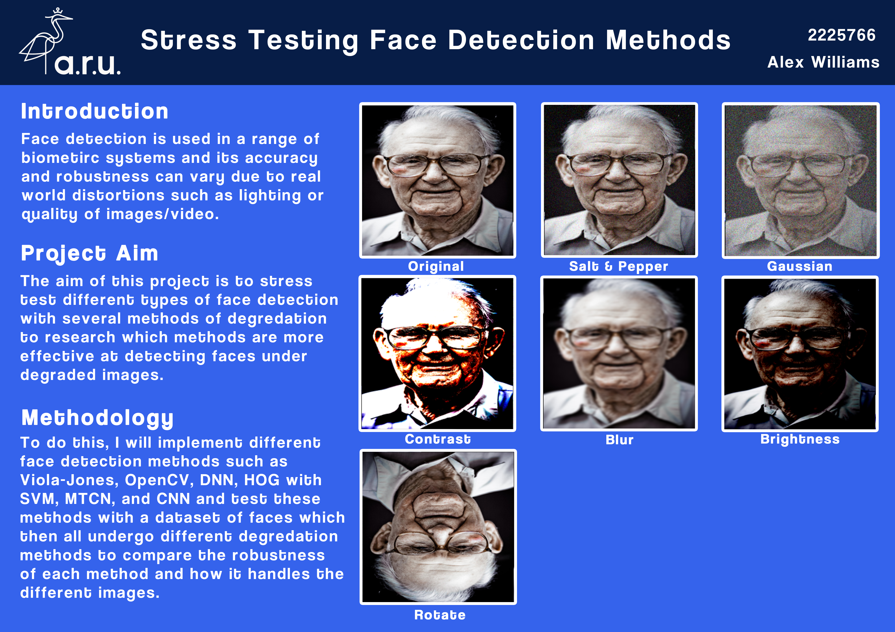
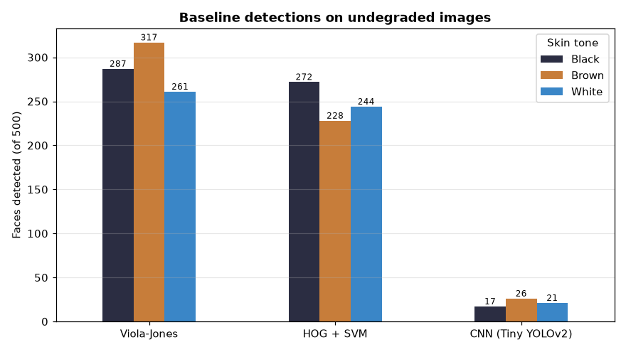
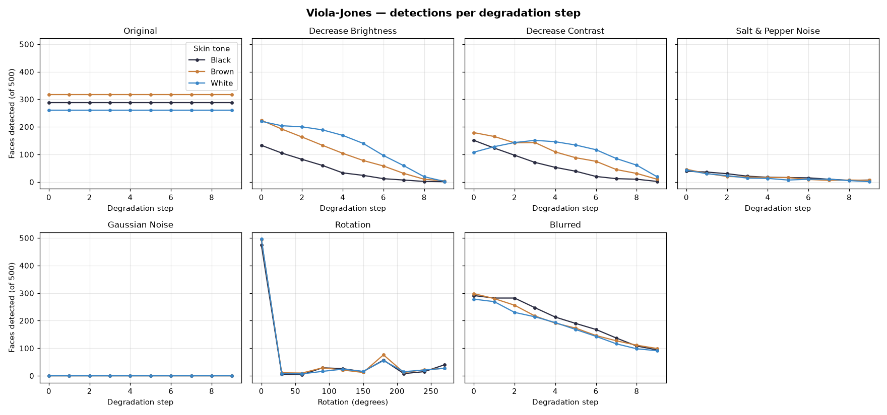
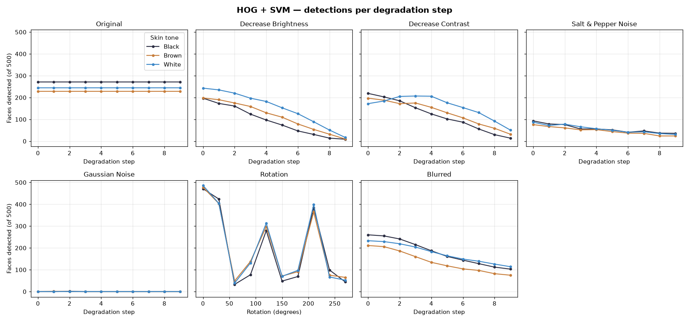
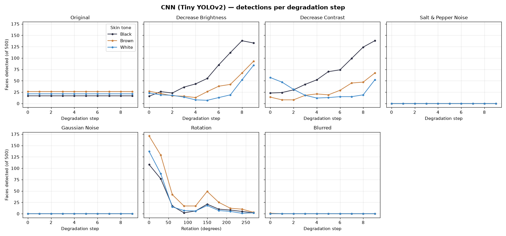

# Stress Testing Face Detection Methods

> BSc Computer Science final-year project (MOD002691), Anglia Ruskin University · Alex Williams

How well do common face detectors hold up when images get worse, and do they fail evenly across skin tones?

This project runs three face detectors (**Viola-Jones**, **HOG + SVM** and a **CNN** built on Tiny YOLOv2) over 1,500 faces split evenly into Black, Brown and White skin-tone groups. Seven types of degradation are applied to each image at **10 increasing intensity levels**, and every detector's success or failure is recorded for each image at each level. That is **630,000 detection runs** in total, all in MATLAB.



📄 **[Read the full report (PDF)](docs/Final_Project_Report.pdf)** · [Interim report](docs/Interim_Report.docx)

---

## Key findings

| Method | Baseline (of 500: Black / Brown / White) | Strengths | Weaknesses |
|---|---|---|---|
| **Viola-Jones** | 287 / 317 / 261 | Most consistent overall; handles blur well; no clear skin-tone bias on clean images | Detects nothing under Gaussian noise; poor under rotation; under low brightness, darker skin tones fall off much faster |
| **HOG + SVM** | 272 / 228 / 244 | Handles blur and some salt & pepper noise; recovers at 90° and 180° rotations | Detects nothing under Gaussian noise; slight weakness on darker skin tones in low light |
| **CNN (Tiny YOLOv2)** | 17 / 26 / 21 | Detections *increase* as brightness and contrast drop | Lowest detection rate overall; detects nothing once blur, Gaussian noise or salt & pepper noise is applied |

**Conclusion:** Viola-Jones is the most suitable of the three for real-world, low-quality camera scenarios. The CNN would likely improve a lot with a modern face-specific model (e.g. YOLOv5/v8), and HOG + SVM could be strengthened with a larger training set. Across all methods, **low light hurt detection of darker skin tones the most**, which shows why fairness has to be tested under degraded conditions and not only on clean images.



---

## Method

### Detectors

| Method | Implementation |
|---|---|
| Viola-Jones | `vision.CascadeObjectDetector` (Haar features + AdaBoost cascade) on the greyscale image. A face counts as detected if any bounding box is returned. |
| HOG + SVM | Image resized to 64×64, HOG features from `extractHOGFeatures`, classified by a custom SVM (`fitcsvm`) trained on a **separate** face / non-face dataset ([`src/hogSVMModel.m`](src/hogSVMModel.m)). |
| CNN | Pre-trained `yolov2ObjectDetector('tiny-yolov2-coco')`. A face counts as detected if a `person` is found. |

### Degradations (10 steps each, `k = 0…9`)

| Degradation | Simulates | MATLAB |
|---|---|---|
| Original (control) | n/a | n/a |
| Decrease Brightness | Poor / uneven lighting | `imadjust(img, [0.5+0.05k, 1], [0 1])` |
| Decrease Contrast | Faded images | `imadjust(img, [max(0.4, 0.45+0.05k), min(1, 0.55+0.05k)], [0 1])` |
| Salt & Pepper Noise | Pixel corruption / transmission errors | `imnoise(img, 'salt & pepper', 0.1+0.01k)` |
| Gaussian Noise | Sensor noise | `imnoise(img, 'gaussian', 0, 0.5+0.05k)` |
| Rotation | Tilted camera / head | `imrotate(..., 30k, 'crop')` (0° to 270°) |
| Blur | Motion blur / out of focus | `imgaussfilt(img, 2+k)` |

### Pipeline

```
for each skin-tone dataset (Black, Brown, White; 500 images each)
  for each method (Viola-Jones, CNN, HOG+SVM)
    for each degradation type (7)
      for each image
        for step k = 0..9
          degrade image in memory → run detector → record 1/0
      write results/<Method>/<Degradation>/<Tone>_Skintone_face_detection_results.csv
```

---

## Results

Each line shows how many of the 500 images in a skin-tone group still had a face detected at each degradation step.

### Viola-Jones


### HOG + SVM


### CNN (Tiny YOLOv2)


The raw per-image results are in [`results/`](results/) (63 CSVs). A condensed first-step / last-step table is in [`results/summary.csv`](results/summary.csv).

---

## Repository structure

```
├── src/
│   ├── facedetection.m      # Main experiment: degrade → detect → write CSVs
│   ├── hogSVMModel.m        # Trains the HOG + SVM face classifier
│   └── graphs.m             # Plots results in MATLAB
├── models/
│   └── hogSVMClassifier.mat # Pre-trained HOG + SVM model
├── results/                 # Per-image detection results (method / degradation / skin tone)
├── figures/                 # Charts used in this README
├── scripts/
│   └── make_figures.py      # Rebuilds figures/ and results/summary.csv from the CSVs
├── docs/
│   ├── Final_Project_Report.pdf
│   ├── Interim_Report.docx
│   └── Poster.png
└── data/                    # Datasets (not included, see data/README.md)
```

---

## Running it

### Requirements
- MATLAB R2023b or later
- Image Processing Toolbox
- Computer Vision Toolbox
- Deep Learning Toolbox
- Statistics and Machine Learning Toolbox
- Computer Vision Toolbox Model for YOLO v2 Object Detection (Add-On)

### Steps
1. Download the datasets into `data/` as described in [`data/README.md`](data/README.md).
2. *(Optional)* Retrain the HOG + SVM classifier. A trained model is already included in `models/`.
   ```matlab
   run src/hogSVMModel.m
   ```
3. Run the experiment. This is slow: it runs 630k detections.
   ```matlab
   run src/facedetection.m
   ```
4. Plot the results in MATLAB:
   ```matlab
   run src/graphs.m
   ```
   or regenerate the README charts with Python (`pandas`, `matplotlib`):
   ```bash
   python scripts/make_figures.py
   ```

> To try it quickly, lower `imageLimit` in `facedetection.m` (e.g. `min(20, numel(imds.Files))`).

---

## Limitations and future work
- Tiny YOLOv2 detects *people*, not faces, which explains its low baseline. Face-specific models such as **MTCNN** and **OpenCV DNN (Res10 SSD)** were planned but not available natively in MATLAB.
- The degradations are synthetic and don't fully capture uneven lighting or occlusion.
- Results are binary (face detected / not detected) with no bounding-box accuracy (IoU) check.
- Larger and more balanced datasets would strengthen the bias analysis.

## Datasets
- [Skin Tone Classification Dataset](https://www.kaggle.com/datasets/usamarana/skin-tone-classification-dataset) (Kaggle): evaluation set
- [Caltech Faces and Non Faces](https://www.kaggle.com/datasets/sagarkarar/caltech-faces-and-non-faces) (Kaggle): HOG + SVM training set

## Acknowledgements
Thanks to Ian van der Linde at Anglia Ruskin University for supervising this project.
